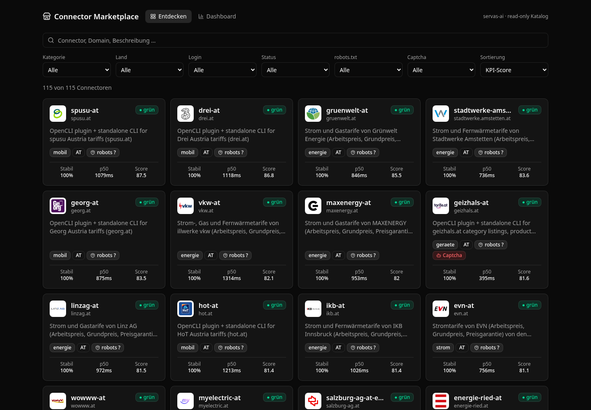
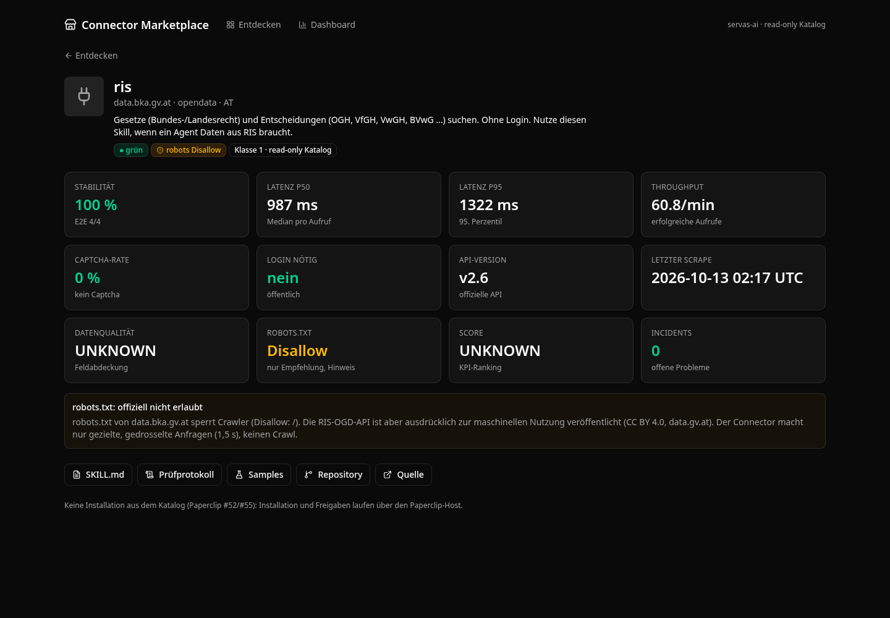
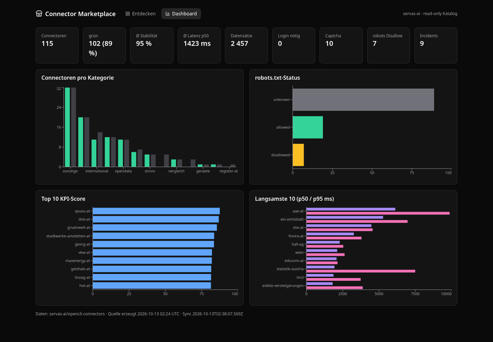

# 🛒 Connector Marketplace

Standalone-Katalog aller servas-ai-Connectoren: Logo-Grid, Suche, Filter, KPI-Detailseiten, Dashboard. Ohne Backend, liest nur `src/data/connectors.json`.



| | |
|---|---|
| 📦 Stack | Vite · React 19 · TypeScript · Tailwind v4 · shadcn/ui · [OpenUI](https://github.com/thesysdev/openui) (`@openuidev/react-lang`) · Recharts |
| 🔄 Daten | `npm run sync` → `scripts/sync-data.mjs` liest [`opencli-connectors`](https://github.com/servas-ai/opencli-connectors): `index.json`, `kpi/ranking.csv`, `SKILL.md`-Frontmatter, `PRUEFPROTOKOLL.md`, Logos |
| 🔍 Filter | Kategorie · Land · Login · Status · robots.txt · Captcha · Sortierung nach KPI |
| 📊 KPIs | Stabilität · p50/p95 · Throughput · Captcha-Rate · Login · API-Version · letzter Scrape · Datenqualität · robots.txt · Incidents |
| 🔐 Paperclip-Regeln | Vertrauensklasse 1 (statischer read-only Katalog, paperclip #55), kein Install-Button, `UNKNOWN` statt geratener Werte (#52/#64) |

## Start
```bash
npm ci
npm run sync -- --src ../opencli-connectors   # optional, sonst Clone
npm run dev          # http://localhost:5173
npm run lint && npm test && npm run build
npm run screenshot   # Playwright → docs/marketplace-*.png
```

## OpenUI
Die KPI-Ansicht ist eine OpenUI-Bibliothek (`src/openui/library.tsx`: `Panel`, `KpiGrid`, `Kpi`, `Notice` auf shadcn-Basis). Die Detailseite erzeugt daraus deterministisch OpenUI Lang und rendert es mit `<Renderer>`. `library.prompt()` liefert den Systemprompt, damit ein Agent später eigene Connector-Ansichten generieren kann, ohne fremden Code auszuführen.

## robots.txt
Wird nur angezeigt („offiziell nicht erlaubt“), nicht gefiltert oder blockiert. Quelle ist das Prüfprotokoll; fehlt es, steht `UNKNOWN`.

| Detail | Dashboard |
|---|---|
|  |  |

Änderungen nur per PR.

CI-Workflow liegt in `ci/ci.yml` (Token ohne `workflow`-Scope); nach `gh auth refresh -s workflow` nach `.github/workflows/` verschieben.
