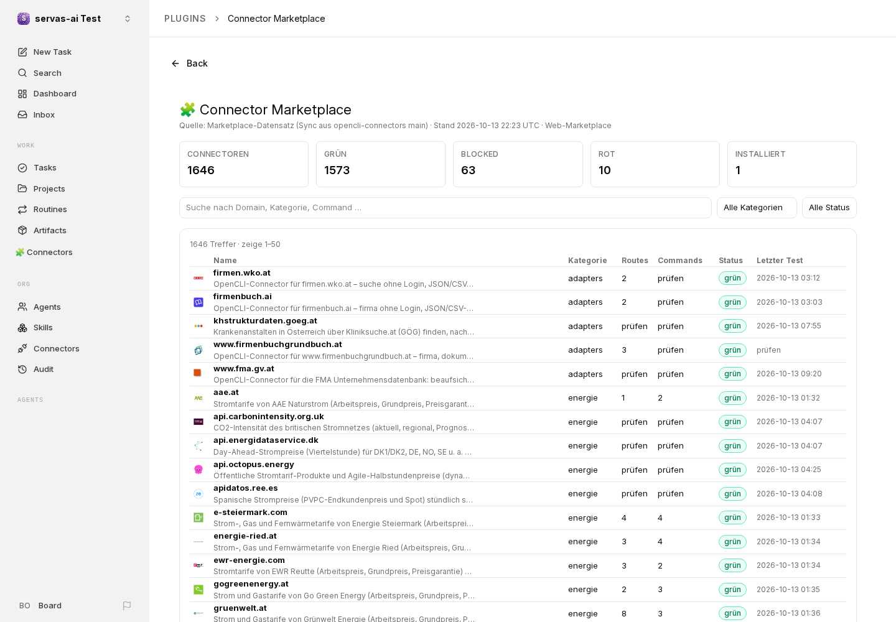
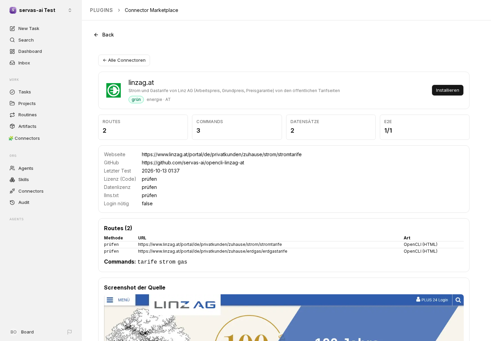

# 🧩 Paperclip-Plugin: Connector Marketplace

Zeigt den servas-ai OpenCLI-Connector-Marketplace direkt in [Paperclip](https://github.com/paperclipai/paperclip) an (Plugin-API v1, `@paperclipai/plugin-sdk` 1.0.0).

| Slot | Inhalt |
|---|---|
| `page` (`/<firma>/connectors`) | Liste aller Connectoren, Suche, Filter nach Kategorie/Status, Paging, Kennzahlen |
| Detail (in der Page) | Logo, Status, Routes (URL + Art), Commands, E2E, Lizenz, llms.txt, Screenshot der Quelle, Rohdaten |
| `sidebar` | Link „🧩 Connectors“ |
| `dashboardWidget` | Anzahl Connectoren / grün / installiert |

Worker-Daten/Aktionen: `catalog`, `connector`, `health` · `install`, `uninstall`, `refresh`.
„Installieren“ speichert den Connector im Plugin-State (Instanz) und zeigt die echten Schritte (`git clone` / Sparse-Checkout + `npm install`). Es wird nichts automatisch ausgeführt.

**Datenquelle:** `https://servas-ai.github.io/connector-marketplace/data/connectors.json`. Das ist der öffentliche Auto-Sync aus `opencli-connectors` main/index.json. Das Hauptrepo ist privat, deshalb wird `index.json` dort nicht direkt geladen. `normalize()` versteht beide Formate. Fehlende Werte zeigt das Plugin als „prüfen“.

## Lokal testen (verifiziert mit Paperclip 0.3.1, Commit e0f30a4)

```bash
# Paperclip (Node ≥ 24.11, pnpm)
git clone https://github.com/paperclipai/paperclip && cd paperclip && pnpm install
pnpm --filter @paperclipai/plugin-sdk ensure-build-deps && pnpm --filter @paperclipai/plugin-sdk build
pnpm paperclipai onboard -d /tmp/pc --bind loopback -y --no-install-service --run   # http://127.0.0.1:3100

# SDK-Tarballs erzeugen (nicht eingecheckt): einmal ein Scaffold anlegen und .paperclip-sdk/ kopieren
pnpm paperclipai plugin init @x/tmp --output /tmp/pinit --sdk-path $PWD/packages/plugins/sdk
cp -r /tmp/pinit/tmp/.paperclip-sdk <dieser-ordner>/

# Plugin
cd <dieser-ordner> && pnpm install && pnpm typecheck && pnpm test && pnpm build
pnpm --dir <paperclip> paperclipai plugin install $PWD -d /tmp/pc
node tests/ui-smoke.mjs   # Playwright-Klicktest, Screenshots nach ./screenshots/
```

Hinweis: `pnpm-workspace.yaml` braucht den Override für `@paperclipai/shared`. pnpm ≥ 10 ignoriert `pnpm.overrides` in der package.json, sonst wird die veraltete npm-Version 0.3.1 gezogen.

## Testlauf 2026-10-13 (lokale Instanz)
- `pnpm test`: 3/3 grün (echte Daten: Marketplace-JSON und index.json von main)
- API: `catalog` q=wien → 16 Treffer; `connector` a1-net → 10 Routes, 5 Commands; `install` → im State gespeichert
- UI (Playwright): Liste 50 Zeilen, Suche „linz“ 9 Zeilen, Detail linzag.at mit 2 Routes, Klick auf „Installieren“ → „Installiert ✓“, Dashboard-Widget sichtbar



